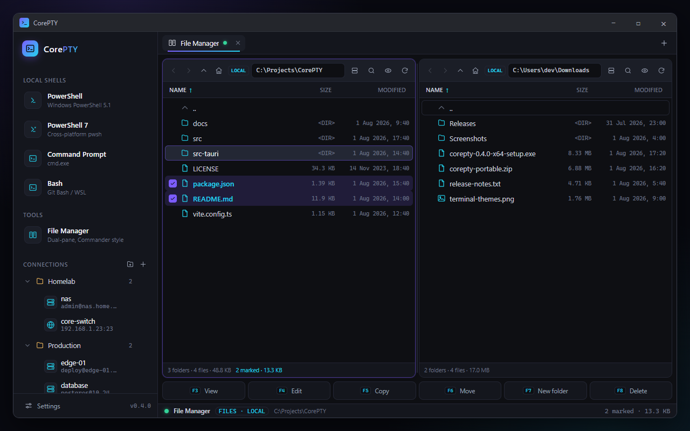
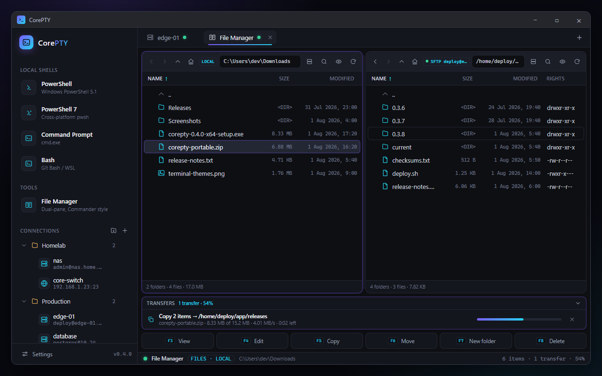
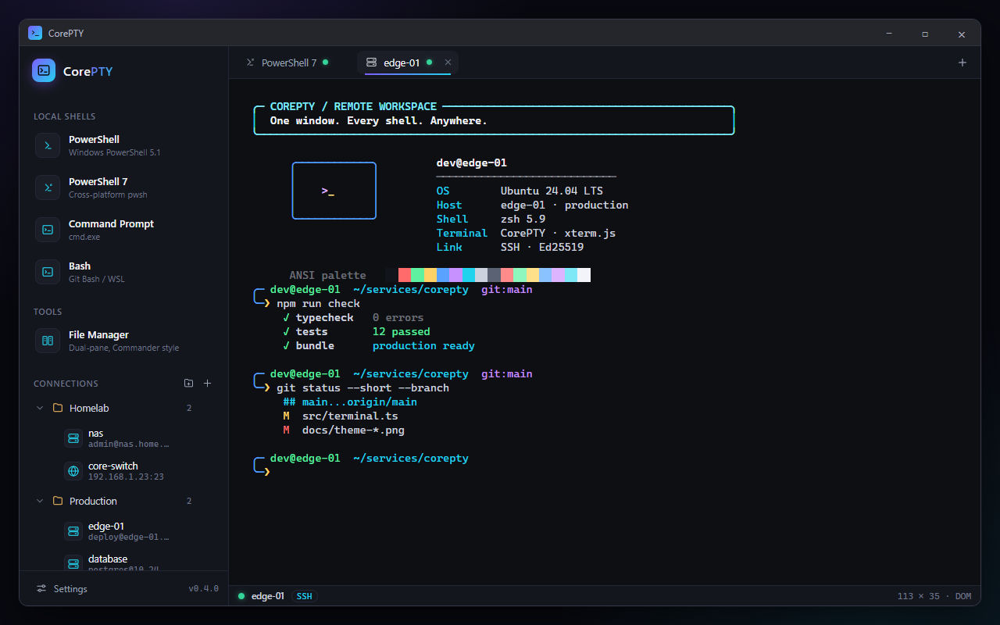
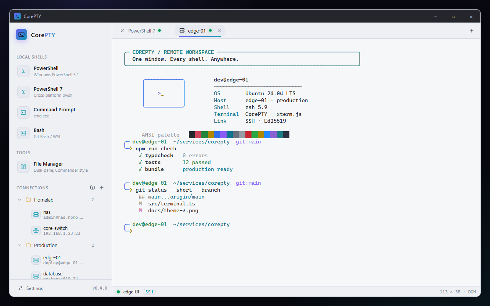
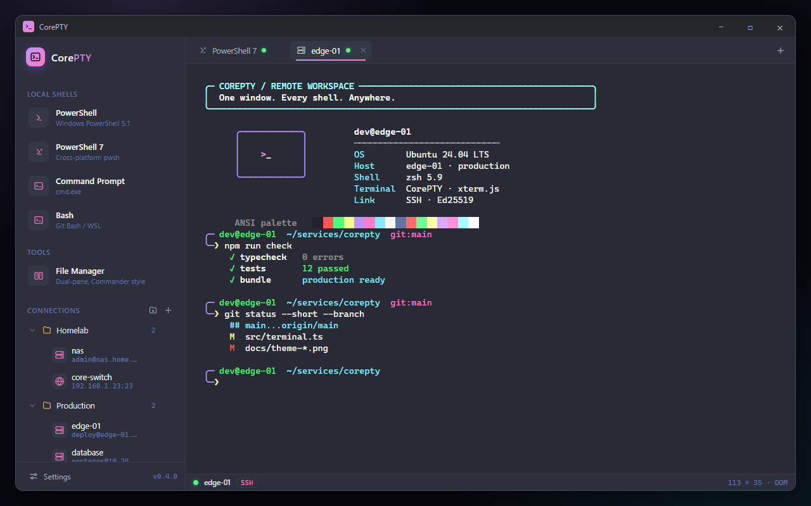
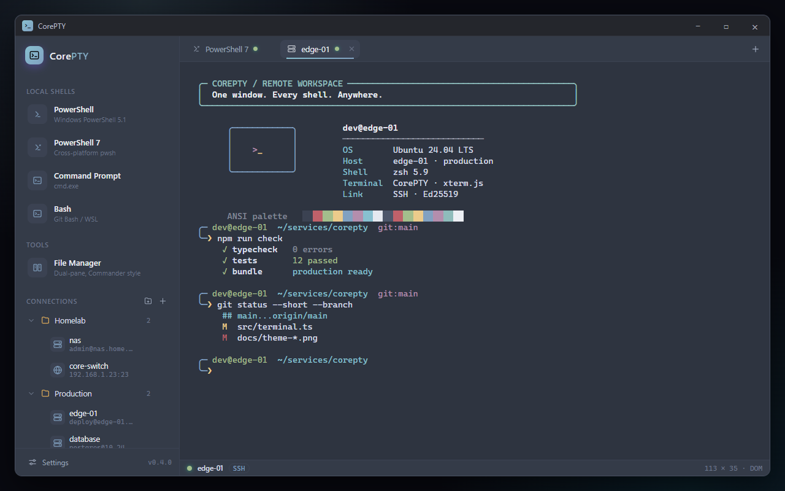
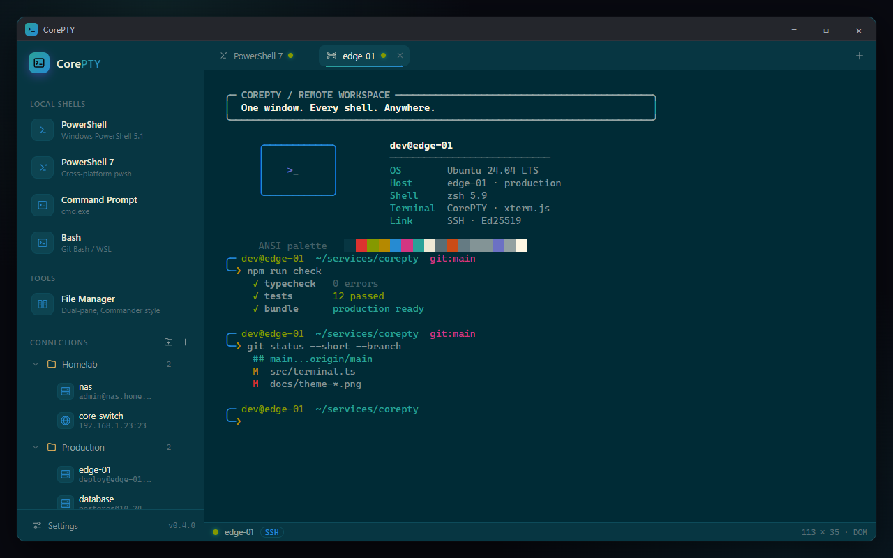
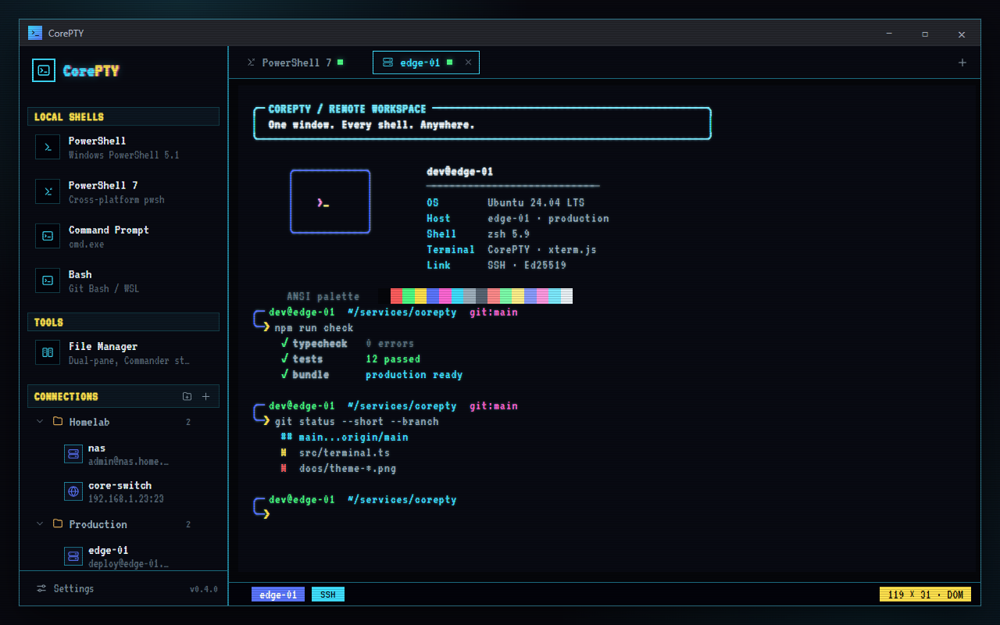
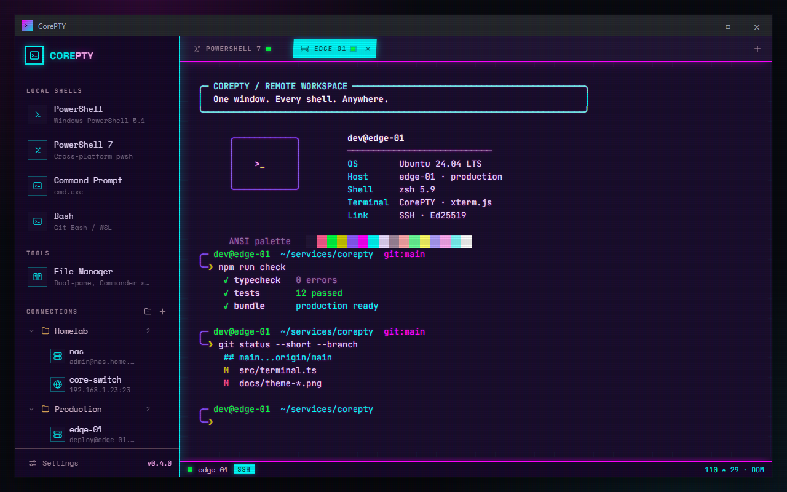
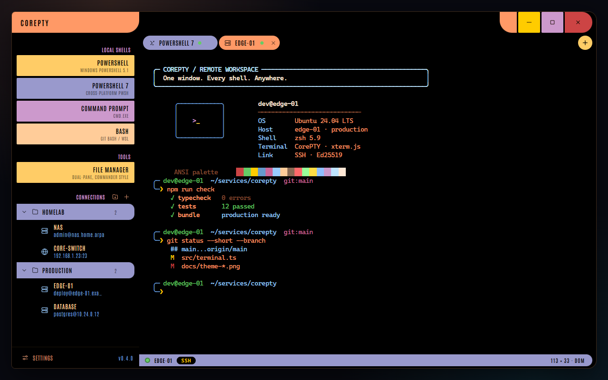

<div align="center">
  

  <h1>CorePTY</h1>

  <p><strong>A cross-platform terminal workspace with local shells, SSH, Telnet, and a dual-pane local and SFTP file manager.</strong></p>

  <p>
    <a href="https://github.com/daniel-leicht/CorePTY/actions/workflows/ci.yml"></a>
    <a href="https://github.com/daniel-leicht/CorePTY/actions/workflows/release.yml"></a>
    <a href="https://github.com/daniel-leicht/CorePTY/releases/latest"></a>
    <a href="LICENSE"></a>
    
  </p>

  
</div>

## Overview

CorePTY is a tabbed desktop terminal workspace built with [Tauri 2](https://tauri.app/),
[xterm.js](https://xtermjs.org/), and Rust. It provides local pseudo-terminal
sessions, SSH connections, Telnet connections, and a Commander-style file manager
for this machine and SFTP servers in one interface, without bundling a Chromium
runtime.

Connection profiles can be organized into nested folders. Saved passwords and
private-key passphrases are stored in the operating system keychain rather than
in the profile file.

## Features

- Local shells backed by native PTYs: ConPTY on Windows and `openpty` on macOS
  and Linux.
- SSH password authentication and Ed25519 or ECDSA private-key authentication
  through [`russh`](https://crates.io/crates/russh).
- SSH host-key verification using `~/.ssh/known_hosts`, with trust on first use.
- Telnet option negotiation for ECHO, SGA, terminal type, and window size.
- Windows administrator sessions through a UAC broker and restricted named
  pipes.
- Saved connections, nested folders, drag-and-drop organization, and custom
  connection colors.
- Dynamic terminal titles, tab duplication, reconnect support, search, and
  configurable right-click behavior.
- A Commander-style file manager (in the spirit of Norton Commander and
  WinSCP): two panels, each showing this machine or an SFTP server, so files
  move local to remote, remote to local, or between two servers.
- SFTP on the SSH connection a terminal tab already has (no second login), or
  on a saved connection; remote panels can follow the terminal's working folder.
- A background transfer queue with progress, speed, and time left; clashes ask
  once per item (overwrite, skip, keep both, newer only, or apply to all), big
  files resume from a `.filepart` after an interruption, and jobs pause while a
  connection is down and carry on after Reconnect.
- Remote files: view in place, open a downloaded copy, or edit one in your
  editor with every save uploaded back (after checking the server's file didn't
  change meanwhile); a Properties dialog with a permissions (chmod) editor.
- Keyboard-first marking (Insert, Space, Shift+movement, numpad masks), quick
  search by typing, filters, history, sortable columns, drag and drop, and a
  clipboard; Trash/Recycle Bin for local files and explicit permanent delete.
- Eight built-in application and terminal themes.
- Configurable fonts, cursor styles, scrollback, bell behavior, minimum
  contrast, and copy-on-select.

### File manager

The file manager keeps the speed and two-panel structure of classic Commander
tools while using CorePTY's current theme and modern desktop conventions. Each
panel shows a location on a filesystem: this machine, or an SFTP server opened
from the location menu (`Alt+F1` / `Alt+F2`), from an SSH tab's context menu
("Open SFTP"), or from a saved connection. Panels on one server share a single
SFTP session, so a move between them is a rename on the server. Remote names
are kept byte for byte; names Windows can't store (`a:b`, `CON`) are saved
under safe spellings when downloaded.

<div align="center">
  
  <br /><br />
  
</div>

## Downloads

Prebuilt packages are available from the
[latest GitHub release](https://github.com/daniel-leicht/CorePTY/releases/latest).

| Platform | Package | Notes |
|---|---|---|
| Windows 10/11 x64 | `CorePTY_<version>_x64-setup.exe` | NSIS installer; upgrades an existing per-user installation in place. |
| Windows x64 portable | `CorePTY_<version>_x64-portable.exe` | Standalone executable; requires the Microsoft Edge WebView2 runtime. |
| macOS universal | `CorePTY_<version>_universal.dmg` | Supports Intel and Apple Silicon. |
| Linux x86-64 | `CorePTY_<version>_amd64.AppImage` | Portable AppImage. Mark it executable before launching. |
| Debian or Ubuntu x86-64 | `CorePTY_<version>_amd64.deb` | Install with `sudo apt install ./CorePTY_<version>_amd64.deb`. |

Release artifacts are currently unsigned. Operating systems may therefore show
a security prompt on first launch.

## Security model

- Saved SSH passwords and key passphrases are held by Windows Credential
  Manager, macOS Keychain, or Linux Secret Service. They are not written to
  `sessions.toml`.
- A previously unknown SSH host key is accepted only if CorePTY can record it
  in `~/.ssh/known_hosts`. A changed key is rejected. Users should independently
  verify a new host's fingerprint when first connecting.
- RSA private keys and RSA-only servers are currently unsupported because the
  available Rust RSA implementation has an unresolved network-observable timing
  side channel. Use Ed25519 or ECDSA keys and host-key algorithms.
- Windows administrator tabs use an elevated broker connected through named
  pipes restricted to Administrators and SYSTEM. The main CorePTY process can
  send input to that elevated shell by design.
- Local file-manager commands run with the normal CorePTY process permissions.
  Native paths remain in the Rust backend as opaque tokens instead of being
  assembled in the webview, and file-manager tabs do not inherit terminal
  elevation.
- SFTP uses the same SSH host-key checks as terminal tabs. Opening SFTP on an
  SSH tab reuses that tab's authenticated connection; a saved connection logs in
  with its keychain secret or asks for the password.
- Remote files that are opened or edited are downloaded into a per-file folder
  under the system temp directory (on Linux, one only you can enter), marked as
  downloaded on Windows (so SmartScreen and Office's Protected View apply), and
  deleted when their tab closes, unless the server is missing changes you made:
  then the copy is kept and you are told where. Opening a remote program or
  script (or a name with text-reversing characters) asks first, since it would
  run on this computer; `F4` opens files in an editor and never runs them.
- Saving an edited file uploads it only after checking that the server's copy
  didn't change meanwhile, keeps its permissions and owner, writes through links
  to the file they point at, and never replaces a folder.
- Telnet provides no transport encryption or server authentication. Use it only
  with systems and networks where cleartext access is acceptable.

## Keyboard shortcuts

On macOS, use Command in place of Control for shortcuts that use `Ctrl`.

| Shortcut | Action |
|---|---|
| `Ctrl+Shift+T` | Open the default local shell |
| `Ctrl+Shift+N` | Open the connection dialog |
| `Ctrl+Shift+E` | Open a local file-manager tab |
| `Ctrl+Shift+W` | Close the active tab |
| `Ctrl+Shift+R` | Reconnect the active terminal session |
| `Ctrl+Shift+F` | Search the active terminal buffer |
| `Ctrl+Shift+C` | Copy the current selection |
| `Ctrl+Shift+V` | Paste through the terminal input handler |
| `Ctrl+,` | Open settings |
| `Ctrl+Tab` | Select the next tab |
| `Ctrl+PageUp` / `Ctrl+PageDown` | Select the previous or next tab |
| Double-tap `Shift` | Open the tab switcher |
| Double-click a tab | Set a custom tab title |

Within a file-manager panel:

| Shortcut | Action |
|---|---|
| `Tab` | Switch active panel |
| `Ctrl+U` | Swap the two panels |
| Arrow keys, `Page Up` / `Page Down`, `Home` / `End` | Move the cursor (marks stay as they are) |
| `Shift` + those keys | Mark a range |
| `Insert` / `Space` | Mark or unmark (`Insert` also moves down) |
| `Ctrl+A` | Mark everything |
| Numpad `+` / `-` / `*` | Mark or unmark files by a mask, invert the marks |
| Typing a name | Jump to it (quick search) |
| `Esc` | End a quick search, close the filter, or clear the marks |
| `Enter` / double-click | Open a folder, or open a file (a remote one as a downloaded copy; programs and scripts ask first) |
| `Backspace` / `Alt+Up` | Open the parent folder |
| `Ctrl+\` | Go to the root folder |
| `Alt+Left` / `Alt+Right` | Navigate folder history |
| `Alt+F1` / `Alt+F2` | Choose a location for the left / right panel: this machine, the panel's server, SSH tabs, saved connections |
| `Alt+Enter` | Properties (size, dates, owner, permissions) |
| `Ctrl+F` | Filter the current folder |
| `Ctrl+R` | Refresh |
| `Ctrl+C` / `Ctrl+X` / `Ctrl+V` | Copy, cut, or paste files |
| `F2` / `Shift+F6` | Rename |
| `F3` | View a text file or image |
| `F4` | Edit: a local file opens with its app; a remote one in your editor (Settings › File manager; blank: Notepad on Windows, the default text editor elsewhere), uploaded on every save |
| `F5` / `F6` | Copy or move to the other panel |
| `F7` | Create a folder |
| `F8` / `Delete` | Move to Trash or Recycle Bin (delete, after confirmation, on servers) |
| `Shift+F8` / `Shift+Delete` | Delete permanently after confirmation |

Operations act on the marked items, or on the one under the cursor when nothing
is marked. Dragging between panels copies by default; hold `Shift` while
dropping to move. Ctrl/Command-click and Shift-click mark with the mouse.

## Themes

CorePTY includes CorePTY Dark, CorePTY Light, Dracula, Nord, Solarized Dark,
BBS, Synapse, and Starbase. A theme changes both the application interface and
the terminal palette.

<table>
  <tr>
    <td align="center" width="50%"><br /><strong>CorePTY Dark</strong></td>
    <td align="center" width="50%"><br /><strong>CorePTY Light</strong></td>
  </tr>
  <tr>
    <td align="center" width="50%"><br /><strong>Dracula</strong></td>
    <td align="center" width="50%"><br /><strong>Nord</strong></td>
  </tr>
  <tr>
    <td align="center" width="50%"><br /><strong>Solarized Dark</strong></td>
    <td align="center" width="50%"><br /><strong>BBS</strong></td>
  </tr>
  <tr>
    <td align="center" width="50%"><br /><strong>Synapse</strong></td>
    <td align="center" width="50%"><br /><strong>Starbase</strong></td>
  </tr>
</table>

## Architecture

| Area | Implementation |
|---|---|
| Desktop shell | Tauri 2 and each platform's native webview |
| Terminal renderer | xterm.js 6 with fit, search, Unicode, web-links, and WebGL addons |
| Local sessions | `portable-pty` |
| SSH | `russh` with the `ring` cryptography backend |
| Telnet | CorePTY's bounded IAC parser over Tokio TCP |
| Credentials | `keyring` with native platform backends |
| File manager | A provider-neutral filesystem layer (this machine and SFTP) with byte-exact paths, a background transfer queue (staged writes, resumable `.filepart` copies, pause on connection loss), and OS Trash/Recycle Bin integration |
| SFTP | CorePTY's SFTP v3 client on `russh` channels: requests pipelined for throughput, connections shared with terminal tabs, file data on its own channel |
| Profiles and settings | Atomically replaced TOML and JSON files in the application config directory |

The frontend and native session drivers communicate through Tauri commands and
binary-safe events. Terminal sessions and file managers implement a shared tab
lifecycle while keeping PTY and filesystem capabilities separated.

## Build from source

### Prerequisites

All platforms require:

- Node.js 20 or later.
- Rust stable.
- The platform prerequisites listed in the
  [Tauri documentation](https://v2.tauri.app/start/prerequisites/).

Additional platform requirements:

- Windows: the MSVC Rust toolchain, Visual Studio 2022 Build Tools with the
  Desktop development with C++ workload, a Windows SDK, and WebView2.
- macOS: Xcode Command Line Tools.
- Debian or Ubuntu:

  ```bash
  sudo apt-get update
  sudo apt-get install -y \
    build-essential file libayatana-appindicator3-dev libdbus-1-dev \
    libgtk-3-dev librsvg2-dev libssl-dev libwebkit2gtk-4.1-dev \
    patchelf pkg-config wget
  ```

### Development

Install the locked frontend dependencies and start Tauri in development mode:

```bash
npm ci
npm run tauri dev
```

### Quality checks

Run the same frontend and native checks used by continuous integration:

```bash
npm run check

cd src-tauri
cargo fmt --all -- --check
cargo clippy --all-targets -- -D warnings
cargo test --all-targets
```

`npm run check` performs TypeScript type checking, runs the Vitest suite, and
produces a release-mode frontend bundle.

The SFTP tests talk to a real OpenSSH `sftp-server` over its standard streams:
Git for Windows ships one, and Linux and macOS have OpenSSH (set
`COREPTY_SFTP_SERVER` to use another binary). Tests against a full sshd are
marked `#[ignore]`; `scripts/sftp-real-tests.sh` starts a throwaway one on
127.0.0.1 and runs them (`--bench` adds a throughput benchmark).

Regenerate the README's deterministic screenshots (the theme gallery and the
file manager, local and with SFTP) on Windows with
`npm run screenshots`.

### Release build

From the repository root:

```bash
npm run tauri build
```

Tauri writes native binaries and installers under `src-tauri/target/release`.
The exact bundle directory depends on the operating system and selected target.

## Release process

The versions in `package.json`, `src-tauri/Cargo.toml`, and
`src-tauri/tauri.conf.json` must match, and [`CHANGELOG.md`](CHANGELOG.md) lists
what each release changes. Push a corresponding version tag to run the
cross-platform release workflow:

```bash
git tag v<version>
git push origin v<version>
```

The workflow validates the versions, runs the automated checks, builds each
platform package, and publishes one GitHub release containing the resulting
artifacts.

## License

CorePTY is licensed under the
[GNU General Public License v3.0 or later](LICENSE).
